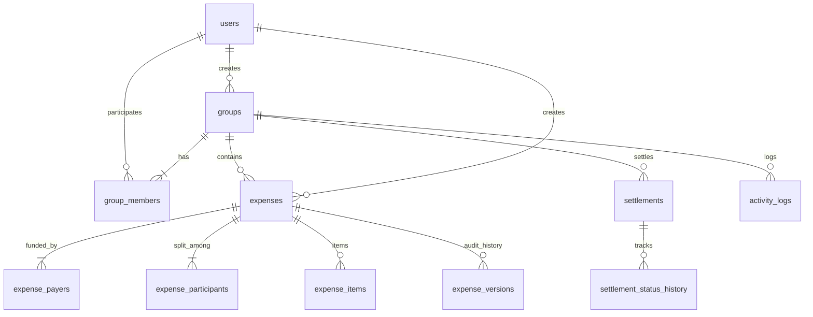

# SettleUpExpenses — PostgreSQL Database Schema

SettleUpExpenses interacts directly with PostgreSQL using the official `pg` driver without an ORM. All monetary values are strictly stored as `BIGINT` integer paise (1 INR = 100 Paise) to avoid floating-point drift and binary rounding anomalies.

---

## Entity Relationship Overview

---

## Tables & Schema Definitions

### 1. `users`
Stores user profile, authentication credentials, and optional UPI ID.
| Column | Type | Constraints | Description |
|---|---|---|---|
| `id` | `SERIAL` | `PRIMARY KEY` | Unique user ID |
| `name` | `VARCHAR(100)` | `NOT NULL` | User full name |
| `email` | `VARCHAR(255)` | `NOT NULL UNIQUE` | Normalized lowercase email |
| `password_hash`| `VARCHAR(255)` | `NOT NULL` | bcrypt salt & hash (never exposed) |
| `upi_id` | `VARCHAR(100)` | `NULLABLE` | Indian UPI VPA (e.g. `user@okhdfcbank`) |
| `created_at` | `TIMESTAMPTZ` | `DEFAULT NOW()` | Registration timestamp |
| `updated_at` | `TIMESTAMPTZ` | `DEFAULT NOW()` | Last update timestamp |

**Indexes**:
- `idx_users_email` ON `users(email)`

---

### 2. `groups`
Stores shared expense groups.
| Column | Type | Constraints | Description |
|---|---|---|---|
| `id` | `SERIAL` | `PRIMARY KEY` | Unique group ID |
| `name` | `VARCHAR(150)` | `NOT NULL` | Group title |
| `description` | `TEXT` | `NULLABLE` | Group purpose or flat address |
| `invite_code` | `VARCHAR(32)` | `NOT NULL UNIQUE` | 8-character uppercase invite code |
| `created_by` | `INTEGER` | `REFERENCES users(id) ON DELETE SET NULL` | Creator user ID |
| `created_at` | `TIMESTAMPTZ` | `DEFAULT NOW()` | Group creation timestamp |
| `updated_at` | `TIMESTAMPTZ` | `DEFAULT NOW()` | Last modification timestamp |

**Indexes**:
- `idx_groups_invite_code` ON `groups(invite_code)`

---

### 3. `group_members`
Tracks membership roles and active status.
| Column | Type | Constraints | Description |
|---|---|---|---|
| `id` | `SERIAL` | `PRIMARY KEY` | Membership record ID |
| `group_id` | `INTEGER` | `REFERENCES groups(id) ON DELETE CASCADE` | Group ID |
| `user_id` | `INTEGER` | `REFERENCES users(id) ON DELETE CASCADE` | User ID |
| `role` | `VARCHAR(20)` | `CHECK IN ('owner', 'admin', 'member')` | Authorization role |
| `status` | `VARCHAR(20)` | `CHECK IN ('active', 'inactive')` | Membership status |
| `joined_at` | `TIMESTAMPTZ` | `DEFAULT NOW()` | Join timestamp |
| `updated_at` | `TIMESTAMPTZ` | `DEFAULT NOW()` | Status change timestamp |

**Constraints**:
- `UNIQUE (group_id, user_id)`

---

### 4. `expenses`
Stores high-level expense records.
| Column | Type | Constraints | Description |
|---|---|---|---|
| `id` | `SERIAL` | `PRIMARY KEY` | Expense ID |
| `group_id` | `INTEGER` | `REFERENCES groups(id) ON DELETE CASCADE` | Group ID |
| `created_by` | `INTEGER` | `REFERENCES users(id) ON DELETE RESTRICT` | User who recorded the expense |
| `description` | `VARCHAR(255)` | `NOT NULL` | Description of expense |
| `total_amount_paise` | `BIGINT` | `CHECK (total_amount_paise > 0)` | Total cost in paise |
| `category` | `VARCHAR(50)` | `DEFAULT 'General'` | Expense category |
| `notes` | `TEXT` | `NULLABLE` | Additional memo or invoice ref |
| `expense_date`| `DATE` | `DEFAULT CURRENT_DATE` | Date of expense |
| `split_type` | `VARCHAR(30)` | `CHECK IN ('equal', 'exact', 'percentage', 'shares', 'adjustment', 'itemized')` | Split algorithm |
| `is_voided` | `BOOLEAN` | `DEFAULT false` | Soft-delete / void flag |
| `voided_by` | `INTEGER` | `REFERENCES users(id) ON DELETE SET NULL` | Voiding user ID |
| `voided_at` | `TIMESTAMPTZ` | `NULLABLE` | Void timestamp |
| `version` | `INTEGER` | `DEFAULT 1` | Incremental edit version |

---

### 5. `expense_payers`
Supports multiple payers per expense. Sum of payer amounts strictly equals `expenses.total_amount_paise`.
| Column | Type | Constraints | Description |
|---|---|---|---|
| `id` | `SERIAL` | `PRIMARY KEY` | Payer record ID |
| `expense_id` | `INTEGER` | `REFERENCES expenses(id) ON DELETE CASCADE` | Expense ID |
| `user_id` | `INTEGER` | `REFERENCES users(id) ON DELETE RESTRICT` | Payer user ID |
| `amount_paise`| `BIGINT` | `CHECK (amount_paise > 0)` | Contribution in paise |

**Constraints**:
- `UNIQUE (expense_id, user_id)`

---

### 6. `expense_participants`
Stores each participant's allocated share. Sum of participant shares strictly equals `expenses.total_amount_paise`.
| Column | Type | Constraints | Description |
|---|---|---|---|
| `id` | `SERIAL` | `PRIMARY KEY` | Share record ID |
| `expense_id` | `INTEGER` | `REFERENCES expenses(id) ON DELETE CASCADE` | Expense ID |
| `user_id` | `INTEGER` | `REFERENCES users(id) ON DELETE RESTRICT` | Participant user ID |
| `share_amount_paise` | `BIGINT` | `CHECK (share_amount_paise >= 0)` | Allocated share in paise |
| `share_value` | `NUMERIC(12, 4)` | `DEFAULT 0` | Stored input (e.g. percentage or shares count) |
| `adjustment_paise` | `BIGINT` | `DEFAULT 0` | Adjustment in paise |

**Constraints**:
- `UNIQUE (expense_id, user_id)`

---

### 7. `expense_items`
Individual items for itemized expenses.
| Column | Type | Constraints | Description |
|---|---|---|---|
| `id` | `SERIAL` | `PRIMARY KEY` | Item ID |
| `expense_id` | `INTEGER` | `REFERENCES expenses(id) ON DELETE CASCADE` | Expense ID |
| `item_name` | `VARCHAR(150)` | `NOT NULL` | Item description (e.g. "Pizza") |
| `amount_paise` | `BIGINT` | `CHECK (amount_paise > 0)` | Item cost in paise |
| `assigned_user_ids` | `JSONB` | `DEFAULT '[]'` | Array of user IDs sharing this item |

---

### 8. `expense_versions`
Audit log of all expense edits, preserving historical snapshots.
| Column | Type | Constraints | Description |
|---|---|---|---|
| `id` | `SERIAL` | `PRIMARY KEY` | Version audit ID |
| `expense_id` | `INTEGER` | `REFERENCES expenses(id) ON DELETE CASCADE` | Expense ID |
| `version` | `INTEGER` | `NOT NULL` | Version index |
| `snapshot` | `JSONB` | `NOT NULL` | Complete state snapshot |
| `modified_by` | `INTEGER` | `REFERENCES users(id) ON DELETE RESTRICT` | User who made edit |
| `reason` | `VARCHAR(255)` | `NULLABLE` | Explanation for modification |
| `created_at` | `TIMESTAMPTZ` | `DEFAULT NOW()` | Timestamp of modification |

---

### 9. `settlements`
Payment proposals and confirmation state machine.
| Column | Type | Constraints | Description |
|---|---|---|---|
| `id` | `SERIAL` | `PRIMARY KEY` | Settlement ID |
| `group_id` | `INTEGER` | `REFERENCES groups(id) ON DELETE CASCADE` | Group ID |
| `created_by` | `INTEGER` | `REFERENCES users(id) ON DELETE RESTRICT` | Proposal creator |
| `from_user` | `INTEGER` | `REFERENCES users(id) ON DELETE RESTRICT` | Payer (debtor) |
| `to_user` | `INTEGER` | `REFERENCES users(id) ON DELETE RESTRICT` | Recipient (creditor) |
| `amount_paise` | `BIGINT` | `CHECK (amount_paise > 0)` | Payment amount in paise |
| `status` | `VARCHAR(20)` | `CHECK IN ('pending', 'marked_paid', 'confirmed', 'rejected')` | Payment lifecycle state |
| `payment_method` | `VARCHAR(30)` | `CHECK IN ('upi', 'cash', 'bank_transfer', 'other')` | Method used |
| `reference_id` | `VARCHAR(100)` | `NULLABLE` | UPI txn ref or UTR |
| `notes` | `TEXT` | `NULLABLE` | Remarks |
| `marked_paid_at` | `TIMESTAMPTZ` | `NULLABLE` | Marked paid timestamp |
| `confirmed_at` | `TIMESTAMPTZ` | `NULLABLE` | Confirmation timestamp |
| `confirmed_by` | `INTEGER` | `REFERENCES users(id) ON DELETE SET NULL` | Recipient who confirmed |
| `rejected_at` | `TIMESTAMPTZ` | `NULLABLE` | Rejection timestamp |
| `rejected_by` | `INTEGER` | `REFERENCES users(id) ON DELETE SET NULL` | Recipient who rejected |

**Constraints**:
- `CHECK (from_user <> to_user)`

---

### 10. `settlement_status_history`
Audit trail of settlement status transitions.
| Column | Type | Constraints | Description |
|---|---|---|---|
| `id` | `SERIAL` | `PRIMARY KEY` | History ID |
| `settlement_id` | `INTEGER` | `REFERENCES settlements(id) ON DELETE CASCADE` | Settlement ID |
| `previous_status` | `VARCHAR(20)` | `NULLABLE` | Previous state |
| `new_status` | `VARCHAR(20)` | `NOT NULL` | Transitioned state |
| `changed_by` | `INTEGER` | `REFERENCES users(id) ON DELETE RESTRICT` | User who made transition |
| `notes` | `TEXT` | `NULLABLE` | Reason or remark |
| `created_at` | `TIMESTAMPTZ` | `DEFAULT NOW()` | Transition timestamp |

---

### 11. `activity_logs`
Chronological timeline for groups.
| Column | Type | Constraints | Description |
|---|---|---|---|
| `id` | `SERIAL` | `PRIMARY KEY` | Log ID |
| `group_id` | `INTEGER` | `REFERENCES groups(id) ON DELETE CASCADE` | Group ID |
| `actor_id` | `INTEGER` | `REFERENCES users(id) ON DELETE RESTRICT` | User triggering action |
| `entity_type` | `VARCHAR(30)` | `CHECK IN ('expense', 'settlement', 'membership', 'group')` | Entity category |
| `entity_id` | `INTEGER` | `NOT NULL` | Entity primary key |
| `action` | `VARCHAR(30)` | `CHECK IN ('created', 'updated', 'voided', 'marked_paid', 'confirmed', 'rejected', 'joined', 'left', 'role_changed')` | Action verb |
| `metadata` | `JSONB` | `DEFAULT '{}'` | Snapshot details (amounts, descriptions) |
| `created_at` | `TIMESTAMPTZ` | `DEFAULT NOW()` | Event timestamp |

---

### 12. `idempotency_records`
Ensures duplicate payment proposals or confirmations are not processed twice.
| Column | Type | Constraints | Description |
|---|---|---|---|
| `id` | `SERIAL` | `PRIMARY KEY` | Record ID |
| `idempotency_key` | `VARCHAR(100)` | `NOT NULL UNIQUE` | Client-supplied unique token |
| `user_id` | `INTEGER` | `REFERENCES users(id) ON DELETE CASCADE` | Authenticated user |
| `route` | `VARCHAR(255)` | `NOT NULL` | API path |
| `response_code` | `INTEGER` | `NOT NULL` | Cached HTTP status |
| `response_body` | `JSONB` | `NOT NULL` | Cached JSON response |
| `expires_at` | `TIMESTAMPTZ` | `NOT NULL` | TTL expiration |
